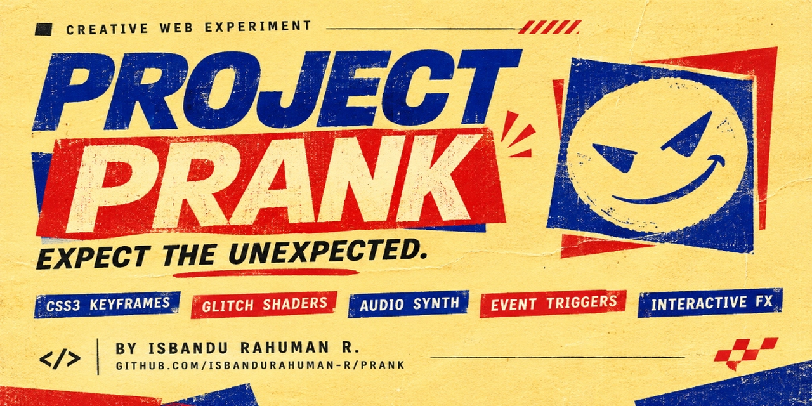

<p align="center">
  
</p>

# ◈ Project Prank

## ◆ About the Project
Project Prank is a client-side interactive web animation and audio experiment. It combines rapid CSS keyframe glitch transformations, viewport jitter animations, and procedural sound synthesis to deliver a lighthearted visual prank experience directly inside the browser.

## ❖ Key Features
- ▪ Viewport glitch shaders and CSS keyframe camera vibration effects.
- ▫ Real-time procedural audio synthesis built with the Web Audio API without external audio files.
- ▴ Single-file zero-dependency architecture that runs entirely client-side.

## ⬢ Technologies Used
- HTML5
- CSS3 Keyframe Animations
- JavaScript (ES6)
- Web Audio API

## § Requirements
- Modern web browser

## ▲ Installation & Execution
```bash
# Open index.html directly or serve locally
python -m http.server 8000
```
Open `http://localhost:8000` in your web browser.

## ※ Developer
Developer: ISBANDU RAHUMAN R  
GitHub: https://github.com/ISBANDURAHUMAN-R
